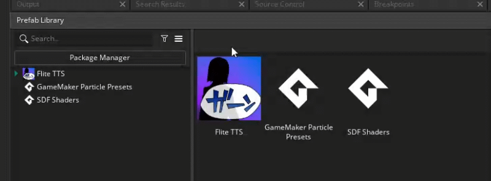

# GM Flite Text-to-Speech

Flite TTS is a text-to-speech prefab for gamemaker. Try out the [Demo](https://hoaniware.itch.io/flitetts-demo) on itch.io. 

Flite TTS wraps the text-to-speech library flite: https://github.com/festvox/flite

Flite TTS is a light weight completely local TTS:
* Runs entirely on your machine - no external servers used
* Fast and responsive - no servers means low latency
* Small - with only the default voice, TTS adds under 3MB to your game. Additional voices are between 5MB to 10MB each.

Supports Web, Windows, Mac and Linux.

This is an entry to the GameMaker Kitchen Cookbook Jam #7

## Installation

Install the `flitetts` prefab, and then add the latest prefab as a collection reference to your project.

## Usage

To generate audio and immediately play it:

```gml
flitetts_speak("Hello World").Play()
```

### `flitetts_speak`

Usage:
```gml
flitetts_speak(text, [voice]) -> FliteTtsAudio
```

* `text` the text to synthesize to speech
* `voice` (optional) a path to a voice `.flitevox` file - `""` will use default.
* `FliteTtsAudio` the synthesized audio object

### `FliteTtsAudio`

Has the following methods:
* `Play([gain], [pitch])`
  * Plays the audio and automatically cleans up once the audio has finished
  * Does nothing if `Play` or `Cleanup` has already been called
    * `gain` (optional) default = 1, set the volume gain of the audio
    * `pitch` (optional) default = 1, adjust the pitch of the playback
* `Sound()`
  * Returns the generated sound object
  * This can be useful if you want to play the sound multiple times, or feed it through your own filters to get more variety from your voices
* `Cleanup()`
  * frees the audio buffer
  * does not need to be called if `Play` is called

### `flitetts_register_voice`

Usage:
```gml
flitetts_register_voice(path)
```

* `path` the local path to the `.flitevox` file

This method is useful for preregistering voices - loading a voice can take a few hundred milliseconds, so it can be a bit jarring the first time it is used.

Calling `flitetts_register_voice` will load that voice prior to using it.

## Voices

The default `flitetts` library comes with a single voice. The advantage of this is that the library is only 3MB.

Additional voices are typically between 5 to 10MB, and can be optionally added through the prefab library by dragging them into your project.



This will add them to GameMaker's Included Files.

You can then play the included voice using:

```gml
flitetts_speak("Hello World", "cmu_us_ahw.flitevox").Play()
```

Replace `"cmu_us_ahw.flitevox"` with whichever voice you wish to use.

To try out different voices, check out the demo project at https://hoaniware.itch.io/flitetts-demo.
